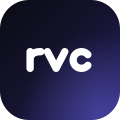
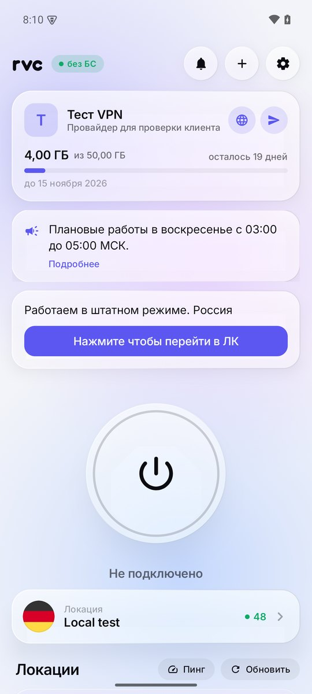
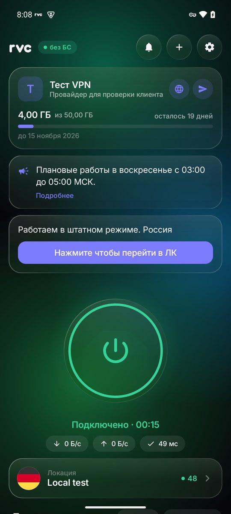
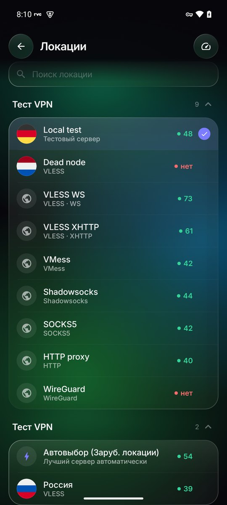
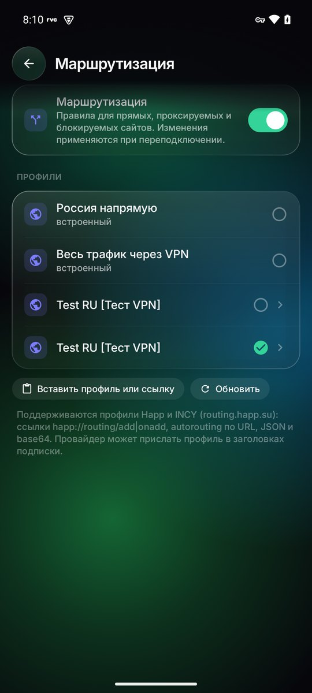
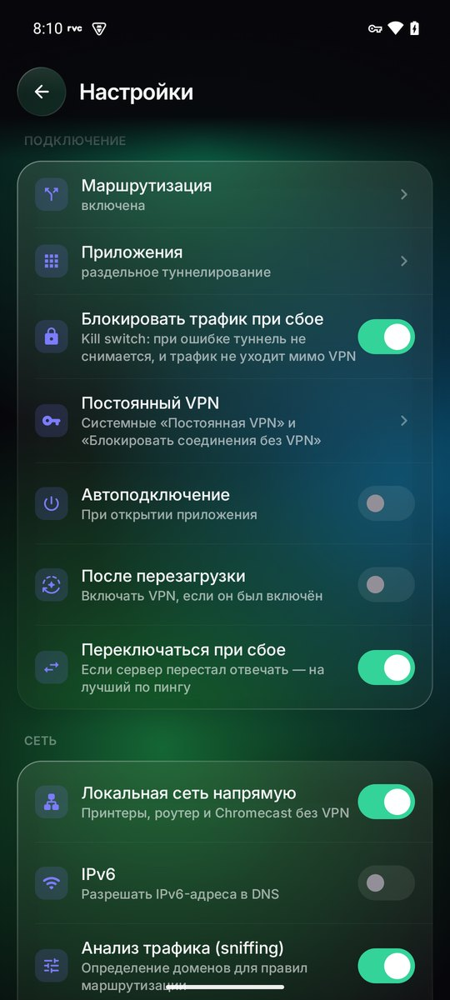
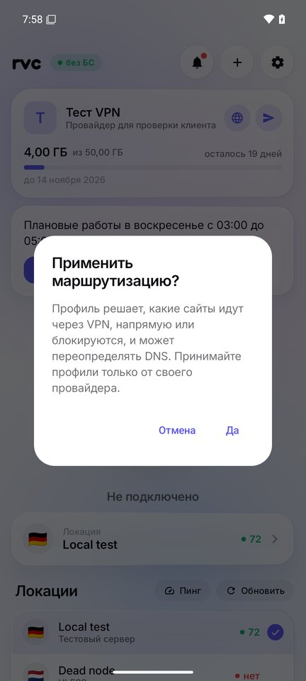

  

<h1 align="center">RVC</h1>

  VPN-клиент для Android: одна кнопка, подписка провайдера и ничего лишнего. 
  Совместим с панелью <a href="https://docs.rw">Remnawave</a> и подписками Happ / INCY.

  <a href="https://makdren.github.io/RVC/"><b>Документация</b></a> · <a href="https://github.com/makdren/RVC/releases/latest"><b>Скачать</b></a>

  
  
  
  

  
  
  

## Скачать

Откройте [последний релиз](https://github.com/makdren/RVC/releases/latest) и выберите файл:

| Файл | Для каких телефонов |
| :-- | :-- |
| `RVC-x.y.z-arm64-v8a.apk` | Почти все современные телефоны — **берите этот** |
| `RVC-x.y.z-armeabi-v7a.apk` | Старые 32-битные телефоны |
| `RVC-x.y.z-universal.apk` | Подходит всем, но весит больше |
| `RVC-x.y.z-x86_64.apk`, `-x86.apk` | Эмуляторы и редкие планшеты на Intel |

Дальше приложение обновляется само: о новой версии придёт уведомление, а перед установкой RVC сверит контрольную сумму и подпись APK.

## Как пользоваться

1. Скопируйте ссылку на подписку из личного кабинета или бота провайдера.
2. Откройте RVC и нажмите **«Из буфера»** — или откройте ссылку `happ://add/…`, которую даёт страница подписки Remnawave.
3. Нажмите большую кнопку. При первом подключении Android попросит разрешение на VPN.

Локацию можно сменить в списке на главном экране или в разделе «Локации», там же — пинг до каждого сервера.

## Возможности

- **Протоколы:** VLESS (Reality, XTLS-Vision, xhttp, ws, gRPC), VMess, Trojan, Shadowsocks, Hysteria2, SOCKS5, HTTP-прокси, WireGuard и AmneziaWG (1.5, 2.0, 3.x). Полные JSON-конфигурации Xray с балансировщиками.
- **Подписки Remnawave, Happ и INCY:** User-Agent `RVC/<версия>` (в Remnawave добавьте [Response Rule](https://makdren.github.io/RVC/provider/#response-rules) `user-agent CONTAINS RVC → XRAY_JSON`), HWID для лимита устройств, имя и описание провайдера, трафик и срок, объявления и баннеры, ссылки на поддержку и сайт, автообновление по интервалу провайдера.
- **Маршрутизация как в Happ и INCY:** те же профили и ссылки (`happ://routing/…`, autorouting), российские сайты — напрямую, реклама — блокируется.
- **Раздельное туннелирование:** банки и госуслуги можно вывести из VPN — они будут работать через обычную сеть.
- **Индикатор белых списков:** бейдж «БС» показывает, ограничил ли оператор интернет белыми списками.
- **Быстрый доступ:** плитка в шторке, виджет на рабочий стол, ярлыки «Подключить» и «Отключить» на иконке.
- **Уведомления провайдера** и напоминание об окончании подписки — без Google-сервисов.
- **Оформление:** «живое стекло», светлая и тёмная темы, плавные анимации, которые не тратят батарею в покое.

  
  
  

## Безопасность

- **Никаких открытых портов.** RVC не поднимает локальные SOCKS/HTTP-прокси на 127.0.0.1: трафик идёт через встроенный TUN ядра. Другие приложения не могут найти прокси сканированием портов и узнать через него IP сервера.
- **Без утечек.** DNS разрешается внутри туннеля, IPv6 не уходит мимо VPN, при сбое туннель не снимается (kill switch).
- **Данные зашифрованы** ключом из Android Keystore: подписки, ключи серверов и настройки не лежат в открытом виде. Резервное копирование данных приложения отключено, журналы ядра в релизе выключены.
- **Ссылки не выполняются молча.** Добавление подписки, импорт маршрутизации и отключение VPN по внешней ссылке требуют подтверждения.

Подробности — в [документации](https://makdren.github.io/RVC/dev/security).

## Для провайдеров

RVC понимает те же заголовки и форматы, что Happ и INCY, поэтому отдельная настройка панели обычно не нужна. Полный список заголовков, формат маршрутизации, deep links и push-уведомлений — в [**документации для провайдеров**](https://makdren.github.io/RVC/provider/).

## Исходный код и сборка

Исходники каждой версии приложены к релизу (`RVC-x.y.z-source.zip`). Как собрать — в [документации](https://makdren.github.io/RVC/dev/build).

RVC основан на [Фарватере](https://github.com/farvater-app/farvater) и распространяется под лицензией GPL-3.0. Используются Xray-core и AndroidLibXrayLite (MPL-2.0), amneziawg-go (MIT), reqwest, rustls, tokio (MIT / Apache-2.0), шрифт Inter (OFL-1.1), флаги [circle-flags](https://github.com/HatScripts/circle-flags) (MIT).
